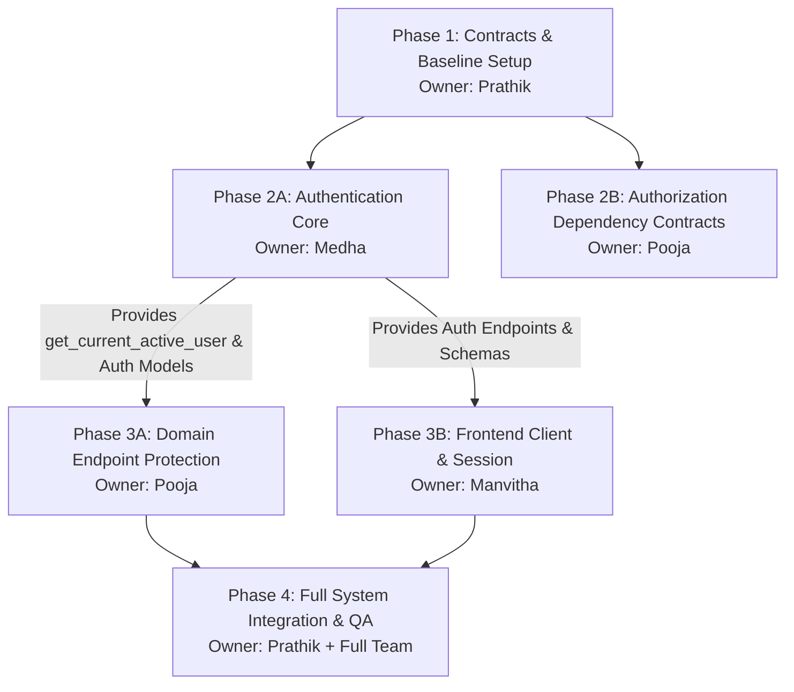

# Milestone 3: Team Implementation Plan
## Authentication and Multi-Tenant Authorization

**Author / Assigned Owner:** Prathik (Team Lead and Backend Integration)  
**Status:** Ready for Team Review & Execution  
**Target Milestone:** Milestone 3  

---

## 1. Team Roster & Ownership Boundaries

To maintain high development velocity and prevent file collision in the Git repository, responsibilities are strictly partitioned:

| Team Member | Core Domain Ownership | Primary File Ownership |
| :--- | :--- | :--- |
| **Prathik** *(Team Lead & Backend Integration)* | Architecture governance, dependency coordination, shared routing, endpoint protection integration, CI verification. | `backend/pyproject.toml` `backend/app/core/config.py` `backend/app/main.py` `backend/app/api/v1/router.py` `backend/tests/test_health.py` |
| **Medha** *(Authentication & Identity)* | Password hashing, JWT access tokens, database refresh tokens, user credential migration, registration & login endpoints. | `backend/app/core/security.py` `backend/app/schemas/auth.py` `backend/app/models/refresh_token.py` `backend/app/services/auth_service.py` `backend/app/api/v1/endpoints/auth.py` `backend/alembic/versions/*_m3_auth.py` `backend/tests/test_auth.py` |
| **Pooja** *(Multi-Tenant Authorization)* | Organization context resolution, RBAC guards, role hierarchy, membership verification, IDOR protection on domain routers. | `backend/app/core/authorization.py` `backend/app/schemas/membership.py` (updates) `backend/app/services/membership_service.py` (updates) `backend/app/api/v1/endpoints/organizations.py` `backend/app/api/v1/endpoints/teams.py` `backend/app/api/v1/endpoints/services.py` `backend/tests/test_authorization.py` |
| **Manvitha** *(Frontend & QA)* | Typed authentication API client, token storage & refresh interceptor, login & register UI components, session state, end-to-end test suite. | `frontend/lib/api.ts` (updates) `frontend/components/auth/*` `frontend/app/login/page.tsx` `frontend/app/register/page.tsx` `frontend/tests/auth.test.mjs` |

---

## 2. Dependency Graph & Sequencing

The implementation consists of four distinct phases with clear dependency handoffs:

### Phase 1: Security Contracts & Repository Baseline (Prathik)
- **Goal**: Lock down settings, dependencies, shared exception types, and base types.
- **Tasks**:
  1. Add dependencies to `backend/pyproject.toml`:
     - `pwdlib[argon2]>=0.2.1`
     - `pyjwt>=2.9.0`
     - `python-multipart>=0.0.12`
  2. Extend `backend/app/core/config.py`:
     - Add `JWT_SECRET_KEY: str = "dev-insecure-secret-key-change-in-production-min32chars"`
     - Add `JWT_ALGORITHM: str = "HS256"`
     - Add `ACCESS_TOKEN_EXPIRE_MINUTES: int = 15`
     - Add `REFRESH_TOKEN_EXPIRE_DAYS: int = 7`
  3. Extend `backend/app/core/exceptions.py`:
     - Add `AuthenticationError(DomainException)`
     - Add `PermissionDeniedError(DomainException)`
     - Add `TenantContextMissingError(DomainException)`
  4. Coordinate shared imports and verify local baseline.

### Phase 2A: Authentication & Identity Engine (Medha)
- **Goal**: Implement credential storage, hashing, token issuance, and login/register endpoints.
- **Tasks**:
  1. Update `User` model (`backend/app/models/user.py`): add `hashed_password` column.
  2. Create `RefreshToken` model (`backend/app/models/refresh_token.py`).
  3. Create single reversible Alembic migration for Milestone 3 schema additions.
  4. Create `backend/app/core/security.py`:
     - Password hashing (`hash_password`, `verify_password`).
     - Token encoding & decoding (`create_access_token`, `create_refresh_token`, `decode_token`).
     - FastApi dependency: `get_current_active_user`.
  5. Implement `backend/app/services/auth_service.py`:
     - `register_user`, `authenticate_user`, `refresh_session`, `logout_user`.
  6. Implement endpoints in `backend/app/api/v1/endpoints/auth.py`:
     - `POST /register`, `POST /login`, `POST /refresh`, `POST /logout`, `GET /me`.
  7. Write comprehensive unit & integration tests in `backend/tests/test_auth.py`.

### Phase 2B & 3A: Multi-Tenant Authorization Engine (Pooja)
- **Prerequisite**: Medha's `get_current_active_user` dependency from Phase 2A.
- **Goal**: Enforce organization context, RBAC, and IDOR protection on all domain resources.
- **Tasks**:
  1. Create `backend/app/core/authorization.py`:
     - Define `OrganizationContext` dataclass (`organization`, `user`, `role`).
     - Implement `get_organization_context` dependency:
       - Checks active membership in `(organization_id, user.id)`.
       - Returns `HTTP 404 Not Found` for non-members (preventing organization enumeration).
     - Implement `require_org_role(*allowed_roles)` dependency factory.
  2. Update domain route handlers:
     - `organizations.py`:
       - `POST /api/v1/organizations`: Automatically binds creator as `OWNER`.
       - `GET /api/v1/organizations`: Filters list to user's memberships only.
       - `GET /api/v1/organizations/{id}`: Requires `get_organization_context`.
       - `POST /api/v1/organizations/{id}/members`: Requires `ADMIN` or `OWNER`.
     - `teams.py`:
       - `POST /teams`: Requires `ADMIN` or `OWNER`.
       - `POST /teams/{id}/members`: Requires `ADMIN` or `OWNER`.
       - `GET /teams`: Requires any valid member.
     - `services.py`:
       - `POST /services`: Requires `MEMBER`, `ADMIN`, or `OWNER`.
       - `POST /service-dependencies`: Requires `MEMBER`, `ADMIN`, or `OWNER`.
  3. Write exhaustive cross-tenant and RBAC tests in `backend/tests/test_authorization.py`.

### Phase 3B: Frontend Client & Session Management (Manvitha)
- **Prerequisite**: API contracts established in Milestone 3 Security Architecture document.
- **Goal**: Update frontend client, build authentication UI, and implement automatic token refresh.
- **Tasks**:
  1. Update `frontend/lib/api.ts`:
     - Implement `login()`, `register()`, `logout()`, `getCurrentUser()`.
     - Implement fetch interceptor with `Authorization: Bearer <token>` injection.
     - Implement automatic 401 retry on token expiration via `/api/v1/auth/refresh`.
  2. Implement UI screens and components:
     - `frontend/app/login/page.tsx`: Clean, accessible login form.
     - `frontend/app/register/page.tsx`: Registration form with client-side password strength validation.
     - `frontend/components/auth/UserNav.tsx`: Displays current user and active organization selector.
  3. Update `frontend/tests/` to verify auth flows and client behavior.

### Phase 4: Integration Checkpoint & Acceptance Validation (Full Team)
- **Led by**: Prathik
- **Tasks**:
  1. Merge and verify full test suite:
     - Medha's auth tests (`test_auth.py`).
     - Pooja's authorization tests (`test_authorization.py`).
     - Existing Milestone 2 tests (`test_organizations.py`, `test_services.py`, etc.) updated with authentication headers.
  2. Execute linting, formatting, and strict type checking (`ruff`, `mypy`, `eslint`, `prettier`).
  3. Run end-to-end multi-tenant isolation scenarios.

---

## 3. Shared File Coordination Protocol

To avoid merge conflicts, team members must adhere to the following rules:

1. **`backend/pyproject.toml`**: Only Prathik modifies this file. Medha requests new dependencies through Prathik.
2. **`backend/app/main.py` & `backend/app/api/v1/router.py`**:
   - Prathik mounts the `/auth` router once Medha's endpoint definition is complete.
   - Exception handlers for new auth errors are added by Prathik.
3. **`backend/alembic/`**:
   - Only **Medha** creates the Milestone 3 migration file (`*_m3_auth_and_refresh_tokens.py`).
   - Down/up migration must be verified reversible before merging.
4. **`backend/tests/conftest.py`**:
   - Prathik updates `conftest.py` with test fixtures: `auth_client`, `test_user`, `test_token`, `test_organization_with_owner`.
   - All team members reuse these standard fixtures.

---

## 4. Acceptance Criteria & Quality Gates

The Milestone 3 deliverables will be marked complete only when all criteria are satisfied:

1. **Zero Unauthenticated Leaks**:
   - All `/api/v1` routes (except `/health` and `/auth/*`) reject requests without valid Bearer tokens with `HTTP 401`.
2. **Strict Multi-Tenant Boundary**:
   - Non-members accessing an existing organization receive `HTTP 404 Not Found`.
   - Cross-tenant service dependencies are physically impossible and verified by automated tests.
3. **Role Enforcement**:
   - `VIEWER` cannot create services, declare dependencies, or create teams (`HTTP 403`).
   - `MEMBER` can create services, but cannot add organization members or modify teams (`HTTP 403`).
   - `ADMIN` can manage services and teams, but cannot promote members to `ADMIN`/`OWNER` (`HTTP 403`).
   - `OWNER` has full administrative authority.
4. **Token Security**:
   - Refresh token reuse triggers automatic invalidation of all sessions for that user.
   - Deactivated users (`is_active=False`) are rejected immediately.
5. **Clean Code & Test Coverage**:
   - 100% passing tests across backend (`pytest`) and frontend (`npm test`).
   - Zero MyPy type errors under `--strict`.
   - Zero Ruff linting or formatting errors.
